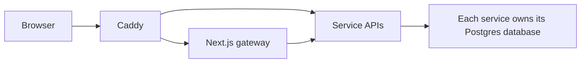

# Architecture and data ownership

Constitution Atlas is a Next.js gateway in front of Kotlin/Spring Boot services. Caddy sends website requests to the gateway and `/api/<service>` requests to the corresponding service. The gateway has no database. Each stateful service owns its Postgres database; services communicate over HTTP and shared opaque IDs, without cross-database foreign keys.

## At a glance

**Main rule:** services exchange HTTP requests and opaque IDs; the gateway has no database and services do not join each other's databases.

| Component | Responsibility |
| --- | --- |
| Catalog | Jurisdictions (countries, regions, and local subdivisions), constitutions, outlines, versions, and publication metadata. |
| Content | Versioned constitutional text and ordered content nodes. |
| Amendment | Legal changes, transitions, revisions, and exact change links. |
| Identity | Accounts, roles, sessions, registration, confirmation mail, SMTP settings, MFA, and passkeys. |
| Editor | Draft sessions, review state, and publication commands. |
| Ingestion | Upload/import jobs and staging before review. |
| Document | Source files and revisions, constitution/legal-change links, contextual page media, and legal-page content. |
| Search | Derived index over published material; rebuilt from source services. |
| Audit | Append-only activity events; not a source of constitutional text. |

The source-of-truth boundaries should be checked against the current [repository map](https://github.com/julianhoelz94/Verfassung/blob/main/docs/CODEMAPS/INDEX.md) and [ADR 0001](https://github.com/julianhoelz94/Verfassung/blob/main/docs/adr/0001-platform-boundaries.md) when adding a feature.

## Deployment setup and transport

Setup gates, TLS and environment precedence

Identity owns durable setup state, the designated bootstrap administrator, deferred email, and the website language policy. Document owns operator details and legal-page drafts/publications. The gateway remains database-free. A setup restriction is enforced at Caddy, the gateway, Identity authentication, and the shared service filter. Until completion, only the bootstrap administrator can use setup operations; content APIs and existing machine/client credentials stay blocked. Existing databases with users receive an explicit legacy-installation migration so an upgrade does not unexpectedly lock out an established site.

Caddy owns direct certificate issuance/renewal with Let's Encrypt HTTP-01. Its supervisor presents credential-free HTTP progress, verifies the issued TLS certificate, and redirects to HTTPS. Caddy's admin socket is private. In external-proxy mode, configured proxy CIDRs and forwarded HTTPS are required; the external proxy owns issuance/renewal. Direct backend ports must remain private. Production rejects local HTTP and CI fixture exceptions.

Configuration is evaluated from actual runtime environment values and owning-service storage. Nonblank environment overrides mask saved values without replacing them. Removing the override restores the saved configuration. Legal environment values prefill private operator drafts; they require save/review/publication and cannot silently rewrite published revisions.

The edge evaluates proxy source-address and forwarded-scheme guards before routing, and keeps the login form behind a verified public HTTPS readiness check. Certificate renewal warnings remain visible in administrator connection settings while a previous certificate is still valid; successful renewal clears the warning.

## Main flows

- **Read:** browser → Caddy → gateway server component → Catalog/Content (and, for context, Amendment or Document). Public responses use published snapshots.
- **Anonymous access:** Identity owns the saved browsing policy. The gateway checks it before showing catalog/navigation or allowing direct reader routes. Caddy asks the gateway edge limiter to enforce the configured per-IP and aggregate API rates for unsigned requests; blocked browsing returns 403, while an exceeded rate returns 429 with `Retry-After`. Sign-in and account creation routes remain available. The limiter currently keeps counters in the gateway process, so multiple gateway replicas need a shared counter store to enforce one aggregate limit.
- **Sign in:** gateway server action → Identity; session cookie is `ca_session`. MFA challenges use a separate short-lived flow.
- **Register:** when enabled by an administrator, Identity accepts an email request and sends a one-use confirmation link. The account remains disabled until the recipient sets a password and initially has only the viewer role. Identity stores SMTP settings and verifies passkeys against the configured public origin.
- **Publish:** an Editor session is saved, reviewed, and approved; a publisher with fresh MFA creates a successor version. Content and Catalog publish the new snapshot, and Search is asked to reindex. The former snapshot remains immutable.
- **Import:** Ingestion stages proposed content. Imports join the editor review and publication queues. Review and publication are explicit separate actions; the same account may perform them with the required roles and fresh publication MFA. No upload by itself publishes content.

Production deployments provision three independent, deployment-managed ingestion credentials after the real bootstrap administrator exists, without enabling demo seeding. Identity stores their hashes with the single scopes `ingestion:publish`, `audit:append`, and `search:reindex`. Manual CD supplies matching values to Identity/Ingestion and rotates them on deployment; restart with unchanged values renews their 90-day lifetime. Missing publication configuration is rejected before claiming the approved job. Safe publication error codes distinguish credential failures, changed approved content and dependency failures; raw downstream response bodies never reach the browser. Existing snapshot pins, role checks, MFA and reconciliation remain mandatory.

Version history has two axes: legal changes and editorial corrections. The legal identity and its source revision must be kept separate; see [ADR 0005](https://github.com/julianhoelz94/Verfassung/blob/main/docs/adr/0005-two-axis-versions.md) and the [design](https://github.com/julianhoelz94/Verfassung/blob/main/docs/design/two-axis-versions.md).

## API addresses

Catalog represents current and historical constitutional jurisdictions as a hierarchy without a fixed depth. Each jurisdiction has a stable UUID, sibling-unique slug, name, kind (such as `country`, `region`, `subregion`, or `municipality`), optional code, and optional parent. A constitution belongs directly to one jurisdiction; its slug aliases and predecessor constitutions are scoped to that jurisdiction. Creating a child does not copy or inherit its parent's constitution. Hierarchy relationships are creation-only in this API.

Set `historical: true` for a country or region that no longer exists. Optional `existedFrom` and `existedUntil` dates describe its existence; omit dates when they are unknown, rather than inventing an exact day. An end date requires a historical jurisdiction and must not precede its start date. Historical jurisdictions remain publicly browsable and their constitutions use the normal review/publication rules. An old constitution of a country that still exists belongs to that continuing jurisdiction; the age of its constitution alone does not make the jurisdiction historical.

No jurisdiction, including a country, requires a modern ISO code. Codes are metadata, not identity: historical entities may reuse a code while retaining separate UUIDs, names, slugs, constitutions, and versions. Current codes remain unique among siblings. A historical region may belong to a historical parent or be a root when that context is not recorded; it does not need to be assigned to a present-day country.

`GET /jurisdictions` lists roots; `?parentId=<uuid>` lists immediate children. `GET /jurisdictions/{id}` returns the jurisdiction, ancestors from root to parent, immediate children, and its own published constitutions. Staff can also see constitution identities that have no published version. Authorized catalog writers use `POST /jurisdictions` and `POST /jurisdictions/{id}/constitutions`. Kinds do not impose a fixed order or a maximum nesting depth, and non-country roots are supported.

Existing country UUIDs also identify their root jurisdiction. The `/countries` APIs continue to describe their existing country records and direct national constitutions. Creating a current country through the jurisdiction API also creates a legacy country record when it has a two-letter code and a slug matching that lowercase code. Historical and uncoded countries, as well as local constitutions, are available through the jurisdiction APIs. Country jurisdictions have no parent. Version details identify their actual owner with `jurisdictionId`; `countryCode` remains the legacy national-owner field and is null when the owner has no legacy country record. Existing version publication and editorial permissions apply at every level. Website navigation, search indexing and ingestion support jurisdiction UUIDs, including uncoded regional and historical collections. Country-code routes remain available for compatible national owners.

Through Caddy, a browser calls `/api/catalog/countries`. Within Compose, a service or gateway calls `http://catalog-service:8080/countries`; the `/api/catalog` prefix is stripped at the edge. Consult the [Caddy configuration](https://github.com/julianhoelz94/Verfassung/blob/main/infra/caddy/Caddyfile) and [API map](https://github.com/julianhoelz94/Verfassung/blob/main/docs/CODEMAPS/backend.md) before adding routes.

[[Development and operations|Technical-Development]] · [[Documentation home|Home]]

## Archive migration ownership

Ingestion owns bounded migration manifests, dependencies, durable attempts and job receipts. Domain writes remain HTTP calls to Catalog, Content, Document and Amendment. Document owns captured bytes and immutable file revisions. Catalog owns source-date evidence, validated exact legacy URL mappings and curated cross-constitution correspondence metadata ([ADR 0007](https://github.com/julianhoelz94/Verfassung/blob/main/docs/adr/0007-curated-archive-comparisons.md)). Content owns typed anchored annotations within immutable rich snapshots. Amendment provides a derived searchable register over published change records.

Prepared import export rechecks principal ownership, reads the actual pinned snapshot with the existing internal credential, then reads source metadata and linked documents through narrow domain APIs. Hash-bound cursors page JSON-pointer leaf records; long strings use indexed `@text` chunks. Consumers must check completeness, mismatch and validation fields, counts and all pages. Source manifest checksums alone do not prove persisted fidelity.

Compose wires Catalog→Document, Ingestion→Document/Amendment and Document→Ingestion in addition to existing service URLs. Configure `ATLAS_LEGACY_HOST` for a controlled alias and `ARCHIVE_LEGACY_HOSTS` on Catalog for matching allowed source hosts; see the operations reference. Deployment instructions remain pending until site CD exists.

Setup proposals retain a monotonically increasing revision, the previous client payload, requested-change feedback, and website display overrides in Ingestion. Conditional writes and the confirmation claim compare the exact revision; a pending change request prevents confirmation. Only a website editor/admin can change display settings, request changes, or confirm. Scoped MCP credentials can read their feedback and revise their hierarchy/sample together, but cannot confirm. Display writes accept only presentation fields and preserve kind codes and source content. Saved display overrides are reapplied to matching kinds in subsequent client revisions. The MCP response exposes the next action and instructs clients to stop until explicit website confirmation; full uploads still require the confirmed constitution and settings pin.

Setup confirmation freezes the reviewed revision and claims it with a fenced, expiring attempt. Catalog atomically creates the constitution, initial settings/outline and operation receipt; exact retries return the same identity and initial settings pin. A stale claim may resume after two minutes. A legacy partial confirmation can reconcile only a previously stored matching constitution ID; an unknown-ID slug collision is not adopted. Confirmation remains separate from staged content review and publication.

Identity and Editor own durable audit outboxes, and Ingestion retains its publication delivery outbox. Audit accepts stable optional event IDs and original occurrence times, deduplicates exact retries and rejects conflicting reuse. Owner database transactions decide whether state-change events commit; authentication failure audit events follow Identity's explicit no-rollback policy. Aggregate operational status requires admin or `operations:read`; it reveals no event payload or actor data.
